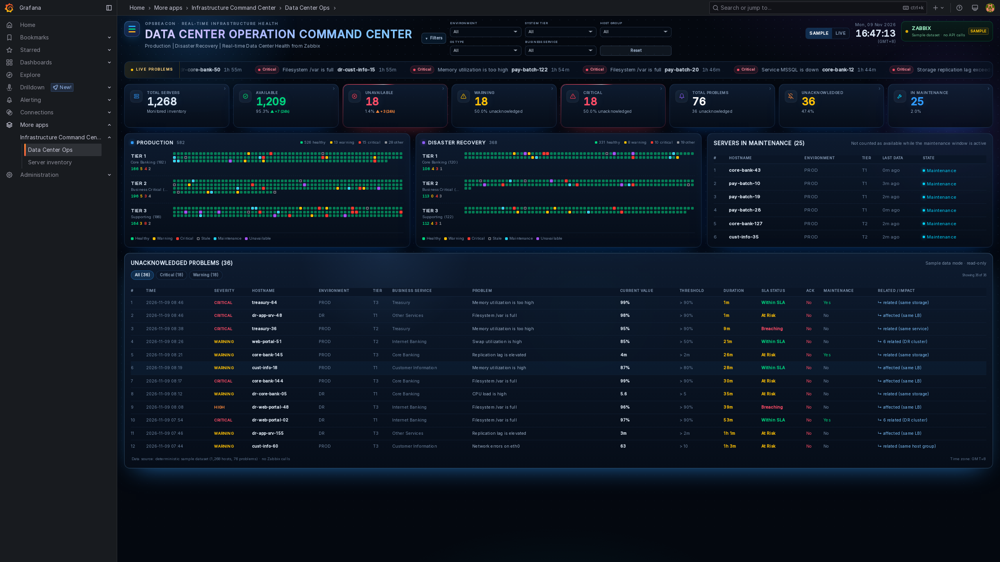
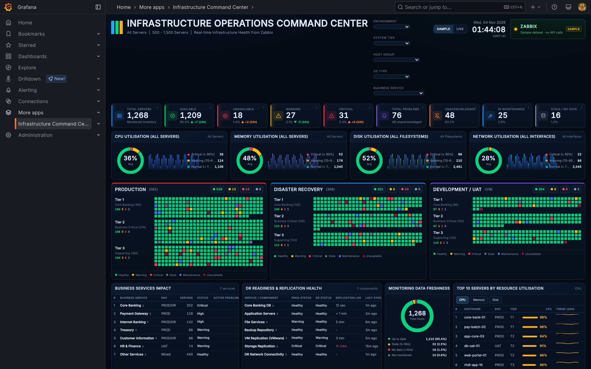
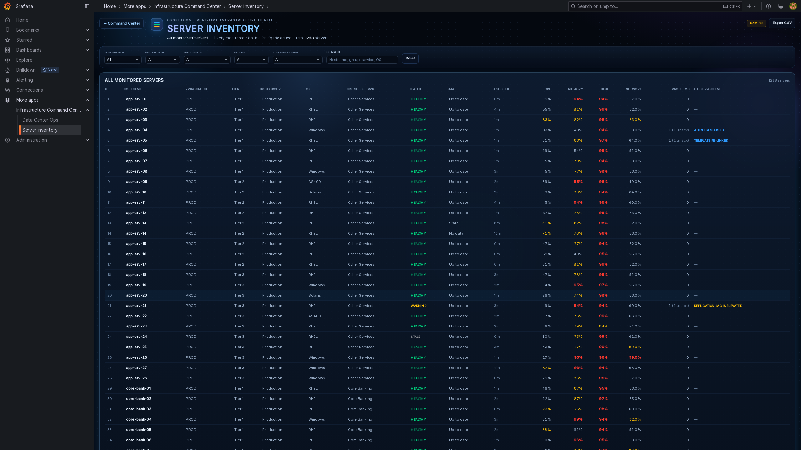
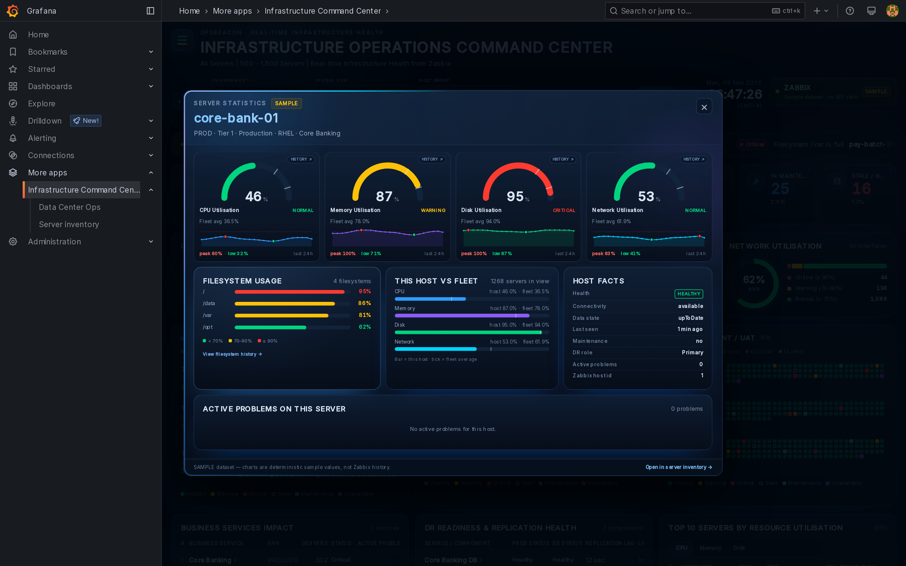

# OpsBeacon

**Infrastructure Operations Command Center for Grafana and Zabbix**

[](RELEASE_NOTES.md#0940)
[](https://grafana.com)
[](https://www.zabbix.com)
[](LICENSE)

OpsBeacon is an enterprise Infrastructure Operations Command Center powered by Grafana and
Zabbix. It presents a Zabbix estate as a single operations wall: inventory health,
availability, utilisation, active problems, data freshness and the busiest servers. It runs
on a deterministic sample dataset for evaluation and on live Zabbix data once the connection
is configured on the plugin's **Zabbix connection** tab.

| | |
| --- | --- |
| **Plugin ID** | `acme-command-center-app` |
| **Display name** | Infrastructure Command Center |
| **Version** | 0.9.40 |
| **Grafana** | >= 11.6.0 |
| **Zabbix** | 7.0 (JSON-RPC API) |
| **License** | GPL-3.0-only |

## Screenshots

[](docs/screenshots/data-center-ops.png)

| Infrastructure Command Center | Server inventory |
| --- | --- |
| [](docs/screenshots/command-center.png) | [](docs/screenshots/server-inventory.png) |

[](docs/screenshots/server-statistics.png)

These screenshots use the deterministic sample dataset, so no Zabbix connection is required
to explore the interface.

## Releases

Release notes for every version, newest first, are in
[RELEASE_NOTES.md](RELEASE_NOTES.md). The detailed change history is in
[CHANGELOG.md](CHANGELOG.md).

## Overview

- **Inventory and health** — every monitored Zabbix host, grouped into PRODUCTION,
  DISASTER RECOVERY and DEVELOPMENT / UAT columns, with tier lanes inside each column.
- **Availability KPIs** — available, unavailable, warning, critical, maintenance,
  stale/no-data and active/unacknowledged problem counts.
- **Data Center Operation Command Center** — a second dashboard (`Data Center Ops`) focused on
  the data-center view: eight fleet KPIs, Production and Disaster Recovery panels that match
  the Infrastructure Command Center's environment panels (status summary, Tier 1–3 lanes and
  clickable host hive grids), the unacknowledged-problem LIVE PROBLEMS marquee, a Servers in
  Maintenance list and the Unacknowledged Problems table.
- **Utilisation** — CPU, memory, disk and network donuts computed from Zabbix item values.
- **Operations panels** — business services, data freshness, top servers with 24-hour
  sparklines, and the active problem table.
- **Filters** — environment, system tier, host group, OS type and business service; all
  panels respond to them.
- **KPI drill-down** — click any KPI count to open a server inventory listing every host
  behind that count, with the same filters applied.
- **Server statistics drawer** — click any square in the environment/tier grids to open
  per-server CPU, memory, disk and network gauges, 24-hour sparklines, filesystem usage,
  fleet comparison, host facts and that host's active problems.
- **Panel row drill-down** — click a Business Services or DR Readiness row to open the
  server inventory filtered to the servers behind that row.
- **SAMPLE / LIVE switch** in the header. SAMPLE never calls Zabbix; LIVE refreshes at the
  interval configured in the plugin settings (60 seconds by default). An administrator can
  disable the sample dataset, making the dashboard live-only.
- **Portable Zabbix connection** — the Zabbix IP/hostname, transport and authentication
  (API token or username/password) are plugin settings, so the same build can be installed
  on a different Grafana server and pointed at a remote Zabbix.

The dashboard is **read-only**. It never acknowledges, closes or creates anything in Zabbix.

## Quick start

1. Open `http://<grafana-host>/grafana/a/acme-command-center-app/command-center`.
   Click any KPI tile to drill into the matching server list. The **Data Center Ops** page
   (`/a/acme-command-center-app/data-center`) provides the data-center-focused view.
2. Open `Administration → Plugins → Infrastructure Command Center → Zabbix connection`
   (or `http://<grafana-host>/grafana/plugins/acme-command-center-app?page=zabbix`) and
   configure the transport, Zabbix address and authentication (API token or
   username/password). Use **Test connection**, then **Save**.
3. Add the host tags described in [Recommended Zabbix tagging](#recommended-zabbix-tagging)
   so hosts land in the right environment, tier and business service.
4. Click **LIVE** in the dashboard header (or clear **Enable sample dataset** in the
   configuration first to make every dashboard live-only).

## Data modes

| Mode | Source | Notes |
| --- | --- | --- |
| **SAMPLE** | `src/data/sampleData.ts` | Deterministic 1,268 hosts, 76 problems, 7 services. Used to validate the design; not your estate's data. |
| **LIVE** | Zabbix API through `src/data/zabbixData.ts` | Real hosts, triggers, items and history. Read-only. |

Filters apply to both modes. The initial mode and the refresh interval are configurable on
the plugin page. If **Enable sample dataset** is ticked (the default), users can switch
between SAMPLE and LIVE in the header. When it is cleared, Grafana-hosted pages are
live-only: the SAMPLE switch is replaced by a `LIVE ONLY` badge, sample drill-down links
fall back to live data, and the page always opens in live mode.

Each open dashboard or tab refreshes independently: it runs its own timer and makes its own
Zabbix request. No live data is shared between tabs, so opening a second dashboard starts its
own refresh cycle immediately and one dashboard can never delay or reuse another's data.
Nothing is written to browser storage by the live poller; the API token and password are
never stored there.

## Data Center Operation Command Center

The **Data Center Ops** page (`/a/acme-command-center-app/data-center`) uses the same data
sources and filters as the main Command Center, with a data-center-focused layout:

| Panel | Content |
| --- | --- |
| **LIVE PROBLEMS marquee** | The same scrolling problem strip as the Command Center, directly under the header, fed only by unacknowledged Warning and Critical problems, with a full-width blank sweep before each loop restart. Hostnames open the per-server statistics drawer. |
| **Top KPI row** | Total Servers, Available, Unavailable, Warning, Critical, Total Problems, Unacknowledged, In Maintenance. **Warning** and **Critical** count only unacknowledged problems by severity and show their share of the unacknowledged set; **Unacknowledged** is exactly Warning + Critical (Info items are informational and not counted). The tiles drill into the matching server inventory. |
| **Environment row** | Production, Disaster Recovery and Servers in Maintenance sit side by side and share a row height; the two environment panels are the same panels as the Infrastructure Command Center. |
| **Production** | The same environment panel as the Infrastructure Command Center: name and total, the healthy / warning / critical / other summary, Tier 1–3 lanes with per-tier status counts, the **hive grid** of clickable host squares and the status legend. |
| **Disaster Recovery** | The same panel scoped to the DR environment. |
| **Servers in Maintenance** | Every host in a Zabbix maintenance window that matches the active filters, sorted by environment and tier, with hostname, environment, tier, last data age and a maintenance badge; the Business Service and OS columns are hidden in the three-column row. Hostnames open the per-server statistics drawer, the list scrolls in its card, and the panel total matches the **In Maintenance** KPI. |
| **Unacknowledged Problems** | The severity-tabbed problem table, limited to **Warning and Critical problems that have not been acknowledged** (no Info tab); tab counts and the panel total match the **UNACKNOWLEDGED** KPI, and hostnames open the per-server statistics drawer. |

Environment status counts partition the environment total; the top **Available** KPI follows
the same definition as the main dashboard (not unavailable, not in maintenance and not
stale), so Warning and Critical hosts remain part of Available.

## How each panel maps to Zabbix

Everything the dashboard shows is derived from four Zabbix calls: `host.get`,
`trigger.get`, `problem.get`, `item.get` (plus `maintenance.get`, `history.get` and
`apiinfo.version`). There is no custom data model to maintain in Zabbix — the dashboard
reads **host groups, host tags, trigger priorities and item keys directly**.

### Host attributes — the key to the whole dashboard

| Dashboard field | Zabbix source | Fallback when absent |
| --- | --- | --- |
| **Hostname** | host technical name (`host`) | — |
| **Environment** (PROD / DR / DEV-UAT) | host tag `environment` or `env`; value matched case-insensitively: contains `dr`/`disaster` → DR, `uat`/`dev`/`test`/`qa` → UAT, `prod`/`prd` → PROD | Inferred from host-group names using the same words; otherwise PROD |
| **System Tier** | host tag `tier`, `system_tier` or `system tier`: contains `1`/`core`/`critical` → Tier 1, contains `2` → Tier 2 | Tier 3 |
| **Host Group** | first host group returned by `host.get` | `Ungrouped` |
| **OS Type** | host inventory `os` / `os_full`: Windows, AIX, Solaris, IBM i (`IBM i`, `AS/400`, `OS/400`, `i5/OS`, `iSeries`); otherwise any `as400.*` item or a `system.uname` value containing one of those names marks the host as IBM i | Linux |
| **Business Service** | host tag `business_service`, `business service` or `service` | `Unassigned` |
| **Health** | maintenance status first, then host/interface availability, then the highest active trigger priority, then data freshness | healthy |
| **Data state** | newest item `lastclock` for the host | `notMonitored` when the host has no items |

Tag values take precedence over host-group names. A tag recipe is in
[Recommended Zabbix tagging](#recommended-zabbix-tagging).

### KPI tiles

| Tile | Definition |
| --- | --- |
| **TOTAL SERVERS** | Monitored hosts returned by `host.get` (`monitored: true`), after filters. |
| **AVAILABLE** | Hosts that are not unavailable, not in maintenance and not stale. | |
| **UNAVAILABLE** | Host `available = 2` or any interface `available = 2`. |
| **WARNING** | Highest active trigger priority is 2 or 3 (`trigger.get`, `value = 1`, `monitored: true`). |
| **CRITICAL** | Highest active trigger priority is 4 or 5. |
| **TOTAL PROBLEMS** | Active `problem.get` rows whose trigger host passes the filters. |
| **UNACKNOWLEDGED** | Problems with `acknowledged = 0`. |
| **IN MAINTENANCE** | Host `maintenance_status = 1`, or the host appears in `maintenance.get`. |
| **STALE / NO DATA** | The host's newest item clock lags the newest item clock in the estate by 5–10 minutes (`stale`) or more than 10 minutes (`noData`). Measured against Zabbix's own item timestamps, not the browser clock. If the whole estate stops advancing for 15 minutes, every host is `noData`. |

Health precedence is maintenance → unavailable → critical → warning → stale → healthy.
Available deliberately excludes maintenance and stale hosts. The tile counts and the
drill-down list use the same predicates, so clicking a count always lists that exact set.

### KPI drill-down — server inventory

Every KPI tile is a link. Clicking it opens the **Server inventory** page at
`/grafana/a/acme-command-center-app/servers` with a `scope` query parameter:

| Scope | Servers listed |
| --- | --- |
| `total` | Every monitored host matching the filters. |
| `available` | Not unavailable, not in maintenance, not stale. |
| `unavailable` | Host or interface reported unavailable. |
| `warning` / `critical` | Highest active trigger priority 2–3 / 4–5. |
| `problems` | At least one active problem. |
| `unacknowledged` | At least one active problem with `acknowledged = 0`. |
| `maintenance` | Host currently in a Zabbix maintenance window. |
| `stale` | Newest item value is 5–10 minutes old or older than 10 minutes. |

The page carries the dashboard's active filters (environment, tier, host group, OS,
business service) into the URL and the back link; for problem scopes it also shows the
number of problems across the listed servers. The inventory itself adds free-text search,
client-side pagination (25/50/100/250 rows, 50 by default), a scope-appropriate default
sort (most problems first for problem scopes, stalest first for stale, otherwise by
hostname) and **Export CSV** of the current result set.
Columns are hostname, environment, tier, host group, OS, business service, health, data
state, last seen, CPU/memory/disk/network utilisation, active problem count (with
unacknowledged count) and the latest problem. Data comes from the same SAMPLE/LIVE source
as the dashboard; the page can also be opened directly, in which case no scope means
`total`.

### Utilisation donuts

Values come from the latest `item.get` result per host. Donut buckets are **≥ 90 % critical,
70–89.9 % warning, < 70 % normal**; the average and bucket counts are computed over the
filtered hosts.

| Donut | Item key | Rule |
| --- | --- | --- |
| **CPU** | `system.cpu.util`; then the aggregate `proc.cpu.util[,,total,,,]` from the AS/400 agent emulator; then the average of all `hrProcessorLoad[<cpu>]` SNMP items | Latest value (%). |
| **Memory** | `vm.memory.util` or `vm.memory.utilization`; then `vm.memory.size[pavailable]`/`[pfree]` (shown as `100 − value`); then `vm.memory.size[available]` or `[free]` divided by `vm.memory.size[total]` | Latest value (%). |
| **Disk** | `vfs.fs.size[<fs>,pused]`, `vfs.fs.dependent.size[<fs>,pused]` or IBM i `as400.disk.size[<unit>,pused]` | The **highest** used percentage across filesystems/disk units wins. |
| **Network** | `net.if.in[<if>]` + `net.if.out[<if>]`; SNMP `ifInOctets`/`ifOutOctets` and `ifHCInOctets`/`ifHCOutOctets` when the item units are bit rates | Summed bit rates converted to a percentage of a **1 Gbps** port (capped at 100 %). Error/dropped/collision keys are ignored. |

If a host has no item for a metric, that host contributes **0 %** for it.

### IBM i / AS/400 hosts

OpsBeacon reads IBM i hosts through the same `host.get` / `item.get` pipeline and maps both
common monitoring routes:

- **AS/400 agent emulator** — the Zabbix community template exposes `proc.cpu.util[,,total,,,]`
  for aggregate CPU, `vfs.fs.size[<ASP or IFS mount>,pused]` for IFS/ASP usage,
  `vfs.fs.state` for mount state and `as400.disk.size[<disk unit>,pused]` for disk-unit
  usage. The `as400.*` keys also identify the host as IBM i when inventory data is missing.
- **SNMP** — IBM i SNMP agents commonly support SNMPv1 or SNMPv3. CPU falls back to the
  per-core `hrProcessorLoad` HOST-RESOURCES items (averaged), memory to
  `vm.memory.size[available|free]` ÷ `vm.memory.size[total]` when a percentage item is not
  available, disk to the percentage filesystem items, and network to `if*Octets` only when
  the template stores them as bit rates. The dashboard never depends on `hrSWRunPerf`,
  which IBM i SNMP agents typically do not implement.

The AS/400 agent-emulator template does not publish RAM items, so memory utilisation on
those hosts needs the SNMP HOST-RESOURCES items or a custom `vm.memory.size[...]` item;
without one, memory reads 0 % rather than an invented value. Both the dashboard donuts and
the server drawer use these fallbacks, including the
historical charts, which average per-core series and invert/derive memory percentages in
the same way as the live snapshot. Sample mode inventories hosts as **RHEL**, **Solaris**,
**Windows** and **AS400**, with IFS-style mounts (`/`, `/QIBM/ProdData`, `/QOpenSys`,
`/home`) for AS400 hosts, so the layouts and OS filter can be reviewed without a Zabbix
server.

### Production / Disaster Recovery / Development-UAT columns

- Column membership is the mapped **Environment** attribute — tag first, host-group names
  as fallback.
- Lanes inside each column are the mapped **Tier 1 / Tier 2 / Tier 3** attributes.
- Badges count hosts by health state within the lane/column.
- Each small square is one host, coloured by health. **Click a square** to open that
  server's statistics drawer.

### Server statistics drawer

Clicking a host square opens a read-only drawer with:

- **Four gauges** for CPU, memory, disk (highest filesystem) and network, with the 70 %
  warning / 90 % critical ticks and the fleet average for the current filtered view.
- **24-hour sparklines** for CPU, memory and disk. In LIVE mode these are fetched
  on demand from `history.get` for that host's items; in SAMPLE mode they are
  deterministic sample lines and are labelled as such.
- **Click any utilisation panel** (CPU, memory, disk or network) to open its historical
  graph. The history view has CPU / Memory / Disk / Network / Filesystems tabs and
  **6H / 24H / 7D / 30D / 90D / 6M** range filters, a point-to-point line with peak and low
  markers, axis labels, threshold lines at 70 % and 90 %, and a hover crosshair with a
  per-series tooltip. The Filesystems tab plots every filesystem on one chart (up to
  eight mounts, with a colour legend and each mount's latest value).
- **Filesystem usage** — one bar per filesystem from
  `vfs.fs.size[<fs>,pused]` / `vfs.fs.dependent.size[<fs>,pused]`; IBM i hosts also read
  ASP/disk-unit usage from `as400.disk.size[<unit>,pused]`. Rows are sorted by usage, with
  the same 70/90 colour bands and a **View filesystem history** link.
- **Host facts** — health, connectivity, data state, last seen, maintenance, DR role,
  Zabbix host ID and active problem count.
- **Active problems on this server**, with severity, current value, age and acknowledgement.
- **Open in server inventory** — jumps to the inventory page pre-filtered to this host
  (`?host=<hostname>`).

Ranges up to 24 hours come from `history.get`; multi-day and multi-month ranges come from
hourly `trend.get` (`value_avg`) and fall back to `history.get` when trends are unavailable.
Samples are averaged into fixed time buckets, and each item's request is capped at 5,000
rows. The drawer fetches live history and filesystem items only when the overview or a
history view is opened; it does not add load to the dashboard refresh. If history or item
data is unavailable, it falls back to the current snapshot and says so. In the history
view, **Esc** returns to the overview; from the overview, **Esc**, the **×** or a backdrop
click closes the drawer.

### Business Services table

Rows are built by grouping hosts on the **Business Service** tag — the Zabbix Services API
is not used. For each service the table shows the environment (or `Mixed`), server count,
active problem count and status (Critical if any host is critical, Warning if any host is
warning/stale, otherwise Healthy). Hosts without the tag appear as **Unassigned**.

To make this panel useful, tag hosts with `business_service=<service name>`.

**Every row is clickable.** The link opens the server inventory filtered by
`businessService` plus the row's environment when it is a single environment (`PROD`,
`DR` or `UAT`). Rows shown as `PROD/DR` or `Mixed` list the service across all
environments. This reproduces the **Servers** count shown on the row.

### DR Readiness & Replication Health table

The table is driven by `DrRow` entries. Each row may carry a `hostFilter` describing which
host attributes identify its servers; clicking the row opens the inventory with those
filters. The sample dataset uses these mappings:

| DR component | Server filter |
| --- | --- |
| Core Banking DB | `environment=DR`, `business_service=Core Banking` |
| Application Servers | `environment=DR`, `tier=Tier 1` |
| File Services | `environment=DR`, `os=Windows` |
| Backup Repository | `environment=DR`, `business_service=Other Services` |
| VM Replication (VMware) | `environment=DR` |
| Storage Replication | `environment=DR` |
| DR Network Connectivity | `environment=DR` |

In LIVE mode this panel is empty because the Zabbix API does not expose DR component or
replication health objects; the row links appear automatically once rows with
`hostFilter` are supplied.

### Data Freshness panel

Counts hosts by data state, based on the **newest item clock of any item returned for the
host** compared with the newest item clock across the whole estate: up to date ≤ 5 minutes,
stale 5–10 minutes, no data > 10 minutes, not monitored when no items exist. Using Zabbix's
own timestamps as the reference means a workstation whose clock is wrong cannot mark every
host stale. If the newest item in the estate has not advanced for 15 minutes (collection
stalled while the API still answers), every host is shown as no data. It is a host-level
signal, not a per-metric one.

### Top Servers panel

The ten hosts with the highest **CPU**, then memory, then disk. Each row shows the mapped
environment, tier, OS and business service plus 24-hour sparklines. Sparklines come from
`history.get` (numeric float, last 24 hours), downsampled to 24 points; when history is
unavailable the line is flat at the current value.

### Active Zabbix Problems table

- Source: active `problem.get` rows, joined to hosts through `trigger.get` (`selectHosts`).
- Severity: trigger priority 4–5 → **Critical**, 2–3 → **Warning**, 0–1 → **Info**.
- **Ack** shows `acknowledged`; reduced/suppressed problems are shown as maintenance.
- **Related** shows the first three problem tags as `tag:value`.
- **Current value** comes from `opdata` when Zabbix provides it; thresholds and SLA are not
  available and show `-` / `Not tracked`.
- Problems whose trigger host is not part of the monitored inventory are not shown.
- The table displays the ten newest problems per severity tab; tab counters use all rows.

### Header filters

| Filter | Uses | Notes |
| --- | --- | --- |
| Environment | mapped Environment | Fixed PROD / DR / DEV-UAT options. |
| System Tier | mapped Tier | Tier 1–3. |
| Host Group | first Zabbix host group per host | Options are built from the current dataset. |
| OS Type | inventory-derived OS | Linux, Windows, AIX, Solaris (whichever exist). |
| Business Service | mapped Business Service | Includes `Unassigned`. |

Problems are filtered by their host's attributes; top servers are matched to the same host
objects in live mode.

## Recommended Zabbix tagging

Set these as **host tags** in Zabbix (Configuration → Hosts → Tags). They are the cleanest
way to drive the dashboard; group names are only a fallback.

| Tag name | Recommended values | Drives |
| --- | --- | --- |
| `environment` (or `env`) | `PROD`, `DR`, `UAT` | Group columns, Environment filter, service rows |
| `tier` (or `system_tier`) | `1`, `2`, `3` (or `Tier 1`, `Tier 2`, `Tier 3`) | Tier lanes, System Tier filter |
| `business_service` (or `business service`, `service`) | Free text, e.g. `Core Banking` | Business Services table and filter |

Example host tags:

```
environment       = PROD
tier              = 1
business_service  = Core Banking
```

Notes:

- Environment and tier values are matched by **substring**, so `production`, `Tier 1` and
  `critical` all work. `development` contains `dev` and is therefore UAT.
- Business service values are displayed **exactly** as tagged and are the row names in the
  Business Services table.
- Host groups still matter for the **Host Group** filter — it shows the first group returned
  by Zabbix for each host.
- Configure inventory fields `os`/`os_full` if you want the OS column and filter to be
  accurate; otherwise hosts are shown as Linux.

## Required Zabbix items

The util panes and sparklines need these item keys. Templates that provide them: *Linux by
Zabbix agent*, *Windows by Zabbix agent*, *AIX by Zabbix agent*.

| Metric | Item key |
| --- | --- |
| CPU | `system.cpu.util` |
| Memory | `vm.memory.util` or `vm.memory.utilization` (fallback `vm.memory.size[pavailable]`) |
| Disk | `vfs.fs.size[<fs>,pused]` / `vfs.fs.dependent.size[<fs>,pused]` |
| Network | `net.if.in[<if>]` and `net.if.out[<if>]` |

## Configuring the Zabbix connection

Open `Administration → Plugins → Infrastructure Command Center → Zabbix connection`. An
organisation Admin is required (the plugin administration area needs `plugins:write`).

| Setting | Meaning |
| --- | --- |
| **Transport** | `Grafana server proxy` (default, same-host nginx) or `Direct API call from the browser` (remote Zabbix) |
| **Proxy path** | nginx location relative to the Grafana sub-path, default `zabbix-api` |
| **Unauthenticated version path** | Location used for `apiinfo.version`, default `zabbix-public` |
| **Zabbix address** | Direct transport only; IP, hostname, base URL or full `api_jsonrpc.php` URL. `/api_jsonrpc.php` is appended when omitted and HTTP is assumed when no scheme is given. |
| **Authentication** | Direct transport only; `API token` (default) or `Username and password` |
| **API token** | Used with the token method; bearer token sent by the browser |
| **Username / password** | Used with the credentials method; exchanged for a Zabbix session token through `user.login` |
| **Live refresh interval** | 15 s – 1 h |
| **Enable sample dataset** | Default on. When off, the dashboard is live-only and the SAMPLE switch is hidden. |
| **Data mode when the page opens** | Sample dataset or live Zabbix; forced to live when sample data is disabled |
| **Animations** | `Follow the system setting` (default), `Always animate` or `Always reduce motion` |

**Save connection** stores the values in Grafana plugin settings for the organisation.
**Test connection** calls `apiinfo.version` and counts monitored hosts with the form values.
Signed-in Viewers receive the same settings (Viewers are granted `plugins.app:access`).

**Animations** controls the aurora drift, LIVE PROBLEMS marquee, title shimmer, gauge fill
and history-chart entrance animations. `Follow the system setting` disables them when the
browser reports `prefers-reduced-motion: reduce`; Windows Remote Desktop sessions and
desktops with animation effects turned off report that by default, which is why a
production Grafana viewed over RDP can look static. Choose **Always animate** for a wall
display that must keep moving regardless of the workstation setting.

### Live Zabbix data path — proxy transport (default)

```
browser (Grafana app)                         settings: transport=proxy
   │  POST /grafana/<proxyPath>/  (session cookie, same origin)
   ▼
nginx
   ├─ auth_request ──► Grafana /grafana/api/user  (rejects unauthenticated requests)
   ├─ adds  Authorization: Bearer <read-only Zabbix API token>
   └─ proxy_pass ─────► http://127.0.0.1/api_jsonrpc.php
```

### Live Zabbix data path — direct transport

```
browser (Grafana app)                         settings: transport=direct
   │  1. POST <Zabbix address>/api_jsonrpc.php   method=user.login   (credentials mode)
   │     ◄─ session token (kept in browser memory for 15 min)
   │  2. POST <Zabbix address>/api_jsonrpc.php   Authorization: Bearer <session token>
   ▼                                              (or the configured API token)
Zabbix api_jsonrpc.php  —  may be a remote host
```

The Zabbix address is a plugin setting, so the same install works on any Grafana server.
The browser must be able to reach the address and the Zabbix API must answer CORS
pre-flight requests for the Grafana origin (`Access-Control-Allow-Origin`,
`Access-Control-Allow-Headers: Content-Type, Authorization`, `Access-Control-Allow-Methods: POST, OPTIONS`).
If Zabbix cannot send CORS headers, put it behind a reverse proxy on the Grafana origin or
use the proxy transport. `apiinfo.version` is always called without the Authorization
header because Zabbix rejects that method when one is present.

Session tokens from `user.login` are kept **in memory only** and are discarded on reload;
the password is only used for that login call. The plugin retries once with a fresh login
if Zabbix reports an expired or revoked session.

> **Direct transport stores the API token or password in `jsonData` in the Grafana
> database, unencrypted.** Any signed-in user who can open the app can read it, including
> Viewers. Use a dedicated read-only Zabbix user, prefer an API token over a password, and
> prefer the server proxy when the secret must stay server-side.

### Installing Grafana on another server (remote Zabbix)

The plugin has no hard-coded Zabbix host. To point a fresh Grafana install at a remote
Zabbix:

1. Install and enable the plugin exactly as in [Install from the package](#install-from-the-package).
   Only Grafana needs the plugin; Zabbix needs no plugin-side changes beyond API access.
2. Open **Zabbix connection** and choose **Direct API call from the browser**.
3. Set **Zabbix address** to the remote server, e.g. `https://zabbix.example.com/zabbix`.
   The effective endpoint is shown under the form.
4. Choose **Username and password** and enter a dedicated read-only Zabbix user, or choose
   **API token** and paste a token for that user.
5. Select **Live Zabbix data** as the opening mode if this install should always be live.
6. Click **Test connection**: the message confirms the Zabbix version, monitored-host count,
   endpoint and account. Save.

If the browser cannot reach Zabbix or the test reports a network failure, check the address,
firewall rules and CORS. Zabbix must return CORS headers that allow the Grafana origin;
`Access-Control-Allow-Origin: *` is the usual setting when the API is not internet-facing.

## Authentication and RBAC

The proxy-mode token should belong to a dedicated Zabbix read-only user whose API
allow-list is limited to:

`host.get`, `hostgroup.get`, `problem.get`, `trigger.get`, `item.get`, `maintenance.get`,
`service.get`, `hostinterface.get`, `history.get`.

Writes and token management should be denied. Keep the token in the nginx configuration
on the Grafana server, readable only by the service account that runs nginx, and do not
commit it to this repository.

The direct transport's **Username and password** mode uses the same read-only account and
calls only `user.login` in addition to the read methods above. The resulting session token
inherits the user's role and expires according to the Zabbix session settings.

### Rotating credentials

- **Proxy transport** — create a new token for `grafana-cc` (Users → API tokens or
  `token.generate`), replace the `Bearer …` value in `/etc/nginx/conf.d/zabbix.conf`, and
  run `systemctl reload nginx`.
- **Direct transport, token method** — paste the new token on the plugin's
  **Zabbix connection** tab.
- **Direct transport, credentials method** — change the password on the **Zabbix connection**
  tab after updating it in Zabbix; existing sessions expire on their own.

Revoke access by disabling the user/token in Zabbix.

## Troubleshooting

| Symptom | Check |
| --- | --- |
| Live mode says `Not authorized` | Token/session missing/expired, the username or password is wrong, or the Zabbix role lacks the methods above. |
| Live mode says `Grafana session expired` | Reload Grafana and sign in; the proxy uses the Grafana session. |
| Direct transport fails only in a browser | The Zabbix address is cross-origin and Zabbix does not send CORS headers; enable CORS on Zabbix or front it with a same-origin reverse proxy. |
| Direct transport says `unreachable` | The browser cannot reach the IP/hostname (VPN, firewall, wrong port) or the address is missing the `/zabbix` path prefix. |
| Test connection says `Login name or password is incorrect` | Check the username/password pair; Zabbix locks or rejects the login, not just the API call. |
| All hosts show PROD / Tier 3 | No `environment`/`tier` host tags and group names carry no environment words. |
| Utilisation shows 0 % on a host | The host is missing the item key or the item has no recent value. |
| Sparklines are flat | `history.get` returned no numeric data in the last 24 h. |
| Problems missing from the table | Their trigger host is not in the monitored inventory or does not match the filters. |
| The header shows `LIVE ONLY` instead of SAMPLE / LIVE | **Enable sample dataset** is cleared in the plugin configuration. |
| Live mode shows no servers after disabling the sample dataset | The URL still carries SAMPLE-mode filters (`source=sample&environment=…&businessService=…`). Version 0.8.1 ignores those stale filters, or click **Clear filters** in the amber `NO SERVERS MATCH FILTERS` banner. |
| No Zabbix connection tab | You are not an organisation Admin. |

## Known limitations

- The plugin is unsigned; Grafana must allow it with `allow_loading_unsigned_plugins`.
- The sample dataset is deterministic and self-contained; it is not a measurement of your
  estate.
- The item query is capped at 5,000 rows per refresh and history at 5,000 points; very
  large estates may see metric/freshness gaps until those limits are raised in
  `src/data/zabbixData.ts`.
- Network utilisation assumes a 1 Gbps access port.
- SLA status, “related/impact” counts and DR replication lag require data this Zabbix does
  not currently provide; the DR readiness panel is intentionally empty.
- Problems, business services and DR rows are derived from host data, not from Zabbix
  Services/SLA objects.

## Install from the package

Download the release archive `acme-command-center-app-<version>.zip` from the
[Releases page](https://github.com/eazt2020/OpsBeacon/releases). It contains one top-level
directory, `acme-command-center-app/`, with the built plugin. On the Grafana server:

```bash
sudo mkdir -p /var/lib/grafana/plugins
sudo unzip acme-command-center-app-0.8.1.zip -d /var/lib/grafana/plugins
sudo chown -R grafana:grafana /var/lib/grafana/plugins/acme-command-center-app
sudo systemctl restart grafana-server
```

Adjust `/var/lib/grafana/plugins` if your Grafana uses a different plugins directory.
Grafana must allow the unsigned plugin:

```ini
[plugins]
allow_loading_unsigned_plugins = acme-command-center-app
```

After restart, sign in as an organisation Admin and open **Administration → Plugins →
Infrastructure Command Center → Zabbix connection** to set the Zabbix address and
authentication. Clear **Enable sample dataset** to make the dashboard live-only.

## Build from source

Node 20 is required to build; no Node.js is needed on the Grafana host at runtime.

```bash
git clone git@github.com:eazt2020/OpsBeacon.git
cd OpsBeacon
npm install
npm run build
```

The deployable files are `dist/module.js`, `dist/module.js.map`, `src/plugin.json`,
`README.md` and `img/`. To install from a source build, copy those files into
`/var/lib/grafana/plugins/acme-command-center-app/` as described in
[Install from the package](#install-from-the-package), using the local paths instead of
the archive.

### Preview without Grafana

`npm run preview:serve` bundles the dashboard and serves `preview/` on
`http://localhost:8091/` using the built-in sample dataset. This is a
development-only harness; it needs no Grafana or Zabbix server. The preview applies a
larger display scale for readability. Rebuild with `npm run preview` after changing
`src/`.

## Repository layout

```
OpsBeacon/
├── src/                  TypeScript/React source
│   ├── plugin.json       Grafana plugin manifest
│   └── data/             Zabbix API, sample data and configuration
├── dist/                 Built plugin (module.js and source map)
├── img/                  Plugin logo
├── docs/screenshots/     README preview images
├── preview/              Standalone preview harness (development only)
├── rollup.config.mjs     Build configuration
├── .github/workflows/    Release workflow (tag push)
├── README.md
├── RELEASE_NOTES.md
├── CHANGELOG.md
└── LICENSE               GPL-3.0
```

## Release process

Releases are cut from tags that start with `v`:

```bash
npm version 0.9.40 --no-git-tag-version   # if the version changed
git commit -am "Release 0.9.40"
git tag -a v0.9.40 -m "OpsBeacon 0.9.40"
git push origin main --tags
```

Pushing the tag runs `.github/workflows/release.yml`, which builds the plugin, packages
`acme-command-center-app-<version>.zip` and publishes a GitHub Release with that archive
attached. The version in `src/plugin.json`, `package.json` and the tag must match.

The release body is only the matching `## <version>` section of
[RELEASE_NOTES.md](RELEASE_NOTES.md), so each release describes its own changes instead of
repeating the full history; older sections stay in the file as the archive.

## Security

- The plugin is **read-only**. It never acknowledges, closes or creates anything in Zabbix.
- In **Direct** transport the Zabbix API token or password is stored in the Grafana plugin
  settings (`jsonData`) and is not encrypted by Grafana. It is delivered to every signed-in
  Grafana user who can open the app, including Viewers, because the browser makes the Zabbix
  calls itself. Use a dedicated read-only Zabbix user and prefer an API token over a password.
  Where the token must stay server-side, use **Proxy** transport.
- In **Proxy** transport the token stays in the nginx configuration on the Grafana server
  and never reaches the browser.
- A Direct endpoint should use `https://`. Over plain `http://` the token or login password
  crosses the network unencrypted; the configuration page warns when such an endpoint is
  saved. Prefer a reverse proxy with a certificate.
- Server inventory CSV exports neutralise spreadsheet formula injection: values that begin
  with `=`, `+`, `-`, `@`, tab or carriage return are prefixed with an apostrophe so Excel
  and Google Sheets treat them as text.
- Do not commit Zabbix credentials, nginx tokens or environment-specific addresses to this
  repository.

## Support

Open an issue at <https://github.com/eazt2020/OpsBeacon/issues>. Include the Grafana version,
Zabbix version, transport in use and the exact error text. Do not paste tokens or passwords.

## License

OpsBeacon is licensed under the GNU General Public License v3.0 only. See [LICENSE](LICENSE).
Copyright (C) 2026 OpsBeacon contributors.
